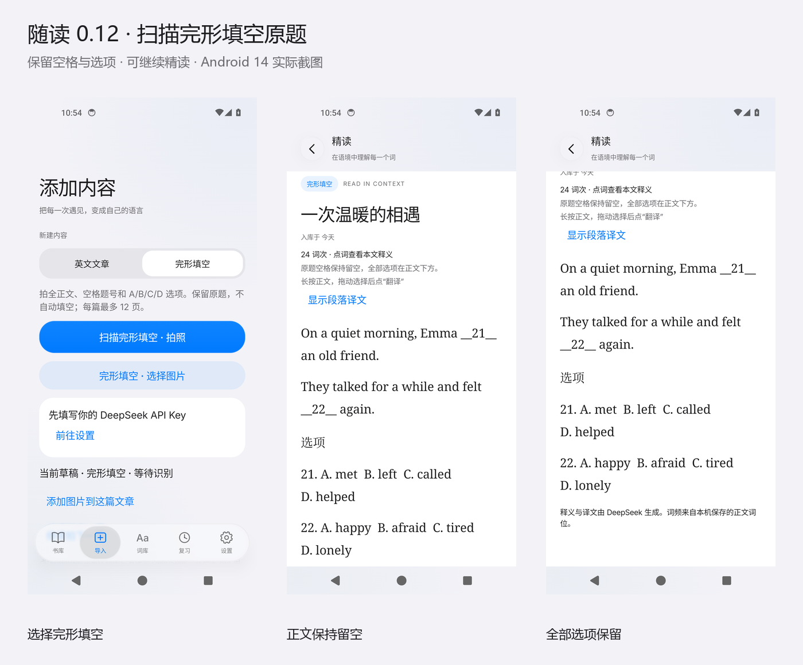

# 词境·随读

在 Android 手机上导入自己的文章和完形填空原题，逐段阅读、点词查义，从原文建立本地词库与复习卡。

最新版本：**[v0.12.0 · 完形填空扫描](https://github.com/Miside/cijing-suidu/releases/tag/v0.12.0)**。支持 Android 12 及以上，包名 `com.yy.suidu`，签名延续原版，可覆盖升级。

## 下载与预览

在 [Releases](https://github.com/Miside/cijing-suidu/releases) 下载 APK。截图预览包解压后打开 `预览.html`，可查看实际应用中的原题核对、留空阅读、选项查词和浅深色外观。



## 扫描完形填空

「导入 → 完形填空 → 拍照 / 选择图片 → 识别原题 → 核对 → 确认原题并逐词解析」。支持多页排序、旋转与继续拍摄。普通文章与完形填空使用各自的识别规则和缓存。

保留正文空格、原题号与全部 A/B/C/D 选项；正文和选项分开核对，缺题或串题会停止并提示。阅读时空格显示为 `__21__`，选项排在正文下方。正文和选项的实际英文均可点词、选择翻译和加入复习，结构字母标签不计词频。译文同样保留空格。

本版按用户确认的范围只保留原题，不加选答案、判分或答案揭晓。OCR 结果仍需对照原图核对。识别和首次解析使用用户自己的 DeepSeek API Key；本版验证未发出真实付费 API 请求。

[详细使用与兼容说明](docs/CLOZE_SCAN_2026-10-28.md)

## 其他功能

- 连续衬线正文、半屏查词、上拉展开、跟手返回、系统触觉与折叠标题。
- 本地词库、词频和原句复习；揭晓后可查词、自动发音，支持移出队列和删除文章。
- 原生长按选段翻译、逐段译文、结合原文提问与本地回答缓存。
- JSON 备份与合并恢复、旧文章词位兼容、三路解析、流式 OCR 上传。
- 悬浮玻璃导航、真实内容采样、边缘折射、触摸高光、拖动回弹和滚动收缩。
- 浅深色主题、降低透明度、阅读字号和自动句译设置；连点版本号 5 次可调整玻璃参数。Inter 字体离线附带并保留授权。

文章、词库、复习与缓存保存在手机本地，API Key 使用本机 Keystore 加密。数据库 v5 保留旧数据；学习备份导出格式 3，恢复支持格式 1–3，单文件上限 32 MiB，备份不含 API Key 和原图。

## 验证

本版的测试数量、APK 哈希、签名与实际截图记录见[验证摘要](docs/verification/v0.12.0.json)。模拟器验证不代表真机相机精度、手感或帧率已测。iOS Liquid Glass 风格由 Android 独立实现。

[本版更新说明](docs/releases/v0.12.0.md) · [上一版阅读与可靠性改动](docs/READING_FLOW_2026-10-23.md)

## 构建

需要 JDK 17、Android SDK 36，项目使用 Gradle 9.1.0。

```sh
./gradlew :mobile:testDebugUnitTest :mobile:assembleDebug :mobile:assembleDebugAndroidTest
```

Windows 使用 `gradlew.bat`。正式安装包输出位于 `mobile/build/outputs/apk/debug/mobile-debug.apk`，测试包单独输出，不用于日常安装。
