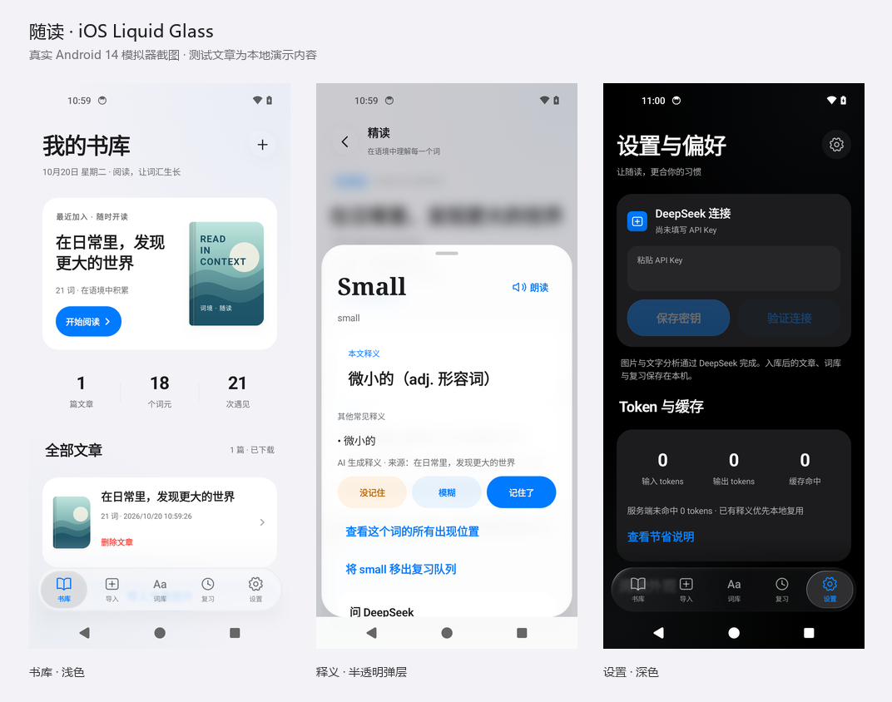

# 词境·随读

在 Android 手机上导入自己的文章图片，逐段阅读、点词查义，并从原文建立本地词库与复习卡。

最新版本：**[v0.10.0 · iOS Liquid Glass](https://github.com/Miside/cijing-suidu/releases/tag/v0.10.0)**。支持 Android 12 及以上，包名 `com.yy.suidu`。

## 下载与预览

在 [Releases](https://github.com/Miside/cijing-suidu/releases) 下载 APK。截图与动效包解压后打开 `预览.html`，可切换浅色 / 深色并查看真实导航录屏。



## 功能

- 多张图片导入、页序与旋转调整、正文识别、主题标题、识别诊断和手动录入。
- 点击单词查看本文释义、词性和常见释义；支持原生长按选段翻译、逐段译文与结合原文提问。
- 词频、本地词库与原句复习。揭晓后可点词查义，切换卡片自动发音，支持移出复习队列和删除文章。
- 悬浮玻璃导航、实时内容采样、边缘折射、触摸高光、拖动回弹和随滚动收缩。
- 封面书库、统一的分组内容与控件、自适应启动图标、浅深色主题、降低透明度及正文字号设置。

图片与文字分析需要配置自己的 DeepSeek API Key。密钥在手机本机加密保存；入库后的文章、词库与复习保存在本地。相同图片、语境与已有释义优先复用本地缓存，服务端缓存命中和用量按实际响应显示。

## 验证

本地交付构建完成 32 项 JVM 测试、Android 14 的 36 项检查及 Android 12 的 35 项检查。两系统各六条弹层关闭路径的正文采样 RGB 平均差值均为 0。Android 12 不支持的 AGSL 专用检查不计入通过数。

本轮未调用真实 API，截图使用隔离模拟器中的演示文章；用户真机帧率尚未实测。这是 Android 对 iOS Liquid Glass 的独立视觉实现。

[更新说明](docs/releases/v0.10.0.md) · [验证摘要](docs/verification/v0.10.0.json)

## 构建

需要 JDK 17、Android SDK 36，项目使用 Gradle 9.1.0。

```sh
./gradlew :mobile:testDebugUnitTest :mobile:assembleDebug
```

Windows 使用 `gradlew.bat`。生成 APK 位于 `mobile/build/outputs/apk/debug/mobile-debug.apk`。源码自行构建使用本机签名；GitHub 发布的 APK 延续此前交付签名。

本仓库是独立随读应用，不依赖旧版应用、私人学习资料或本机工具链。
